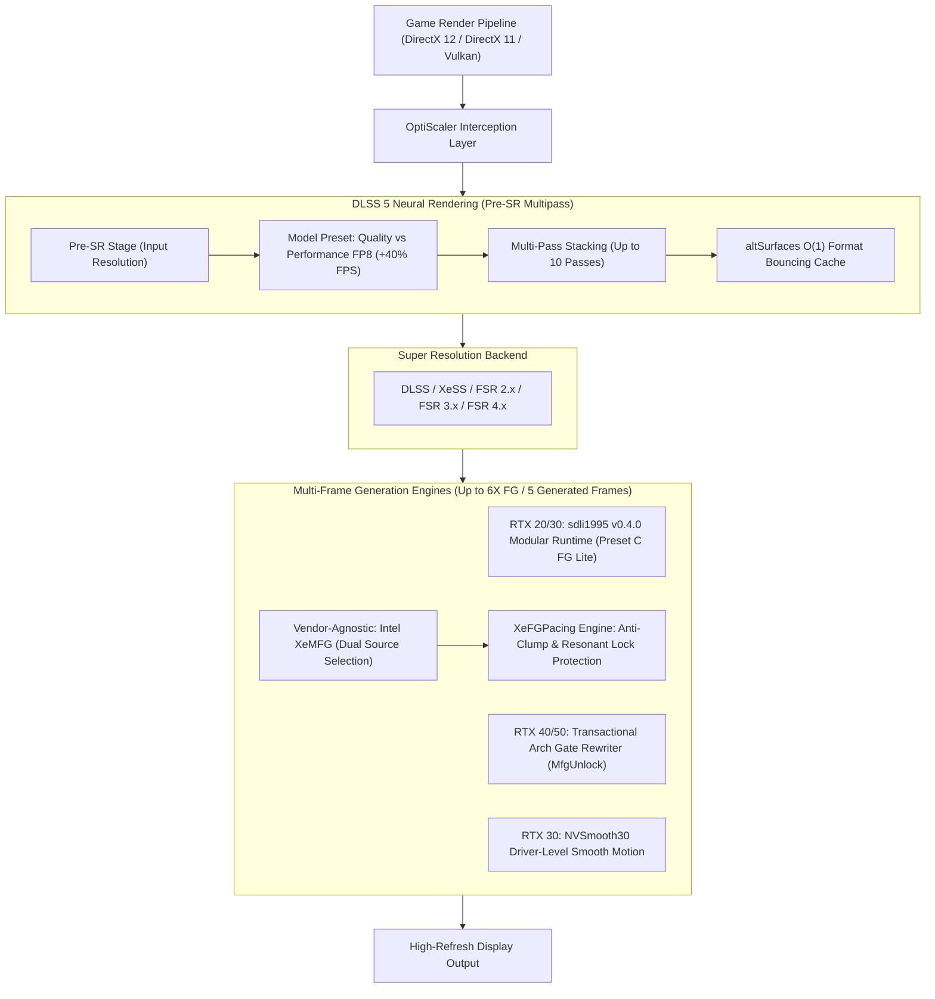

# OptiScaler: Next-Gen Neural Rendering & Multi-Frame Generation Suite

[](https://github.com/ShyVortex/OptiScaler-DLSSNR-PreSR-Multipass/releases)
[](https://github.com/ShyVortex/OptiScaler-DLSSNR-PreSR-Multipass/actions)
[](LICENSE)
[](https://en.cppreference.com/w/cpp/20)
[](https://github.com/ShyVortex/OptiScaler-DLSSNR-PreSR-Multipass)
[](https://discord.gg/wEyd9w4hG5)

A high-performance, next-generation AI image reconstruction, neural processing, and **Multi-Frame Generation (up to 6X FG)** middleware suite.

This repository (**ShyVortex/OptiScaler-DLSSNR-PreSR-Multipass**) is an advanced evolutionary fork of [OptiScaler](https://github.com/optiscaler/OptiScaler) and [wilsjo2/OptiScaler-DLSSNR-PreSR-Multipass](https://github.com/wilsjo2/OptiScaler-DLSSNR-PreSR-Multipass). It unifies production-grade **DLSS 5 Neural Rendering (DLSS-NR) Pre-SR Multipass**, deep hardware **Multi-Frame Generation** across four GPU generations (Turing, Ampere, Ada Lovelace, Blackwell), universal vendor-agnostic **Intel XeMFG** with custom presentation pacing engines, and driver-level **Smooth Motion** for RTX 30 series GPUs.

**[Download Latest Release](https://github.com/ShyVortex/OptiScaler-DLSSNR-PreSR-Multipass/releases/latest)** · **[Installation Guide](INSTALL-DLSSNR.md)** · **[Configuration Guide](Config.md)** · **[Report an Issue](https://github.com/ShyVortex/OptiScaler-DLSSNR-PreSR-Multipass/issues)**

---

## 🌟 What Sets This Fork Apart?

While upstream forks focused narrowly on experimental post-upscaling Neural Rendering passes and omitted or deprecated hardware Multi-Frame Generation mods, the **ShyVortex** fork bridges cutting-edge AI neural enhancement and ultra-smooth frame generation into a unified, hardened runtime:



---

## 📊 Feature Comparison Matrix

| Feature | **ShyVortex Fork** (This Repo) | **Upstream wilsjo2** | **Stock OptiScaler** |
| :--- | :---: | :---: | :---: |
| **DLSS 5 Neural Rendering (DLSS-NR)** | **Pre-SR Default & Multipass** | Post-SR Default (Experimental) | ❌ None |
| **Lightweight FP8 Model ("Crazy Cuckoo", +40% FPS)** | ✅ **Yes (Preset 2 FP8 Tensor Core)** | ❌ None | ❌ None |
| **Model Preset Selector & Multi-Pass Inheritance** | ✅ **Yes (In-game UI, up to 10 passes)** | ❌ Limited / Manual INI | ❌ None |
| **Cutscene Camera-Cut Format Bouncing Stability** | ✅ **Yes (`altSurfaces` Zero-Alloc Cache)** | ❌ Stutter / Crash (#33) | ❌ None |
| **Self-Healing Pipeline Diagnostics & One-Click Pre-SR** | ✅ **Yes (In-game error reporting & action)** | ❌ Infinite "Waiting" Loop | ❌ None |
| **RTX 20 / 30 (SM75/SM86) Multi-Frame Generation** | ✅ **Yes (sdli1995 v0.4.0 modular runtime)** | ❌ Removed / Omitted | ❌ None |
| **UI Recomposition Presets (Auto / A / B / C FG Lite)** | ✅ **Yes (Preset C saves 30–50% GPU time)** | ❌ None | ❌ None |
| **RTX 40 / 50 (Ada/Blackwell) Transactional MFG Unlock** | ✅ **Yes (Built-in `OPTISCALER_RTX40_MFG`)** | ❌ Excluded / Disabled | ❌ None |
| **Vendor-Agnostic Intel XeMFG (Up to 6X Multi-Frame Gen)**| ✅ **Yes (5 Transactional Binary Patches)** | ❌ None | ⚠️ 2X Only (Stock XeFG) |
| **Dual Source XeMFG Routing (`Game` vs `OptiScaler`)** | ✅ **Yes (Injects into DLSS-G or DLSS-SR)** | ❌ None | ❌ None |
| **Native Presentation Thunk Pacing Engine (`XeFGPacing.h`)** | ✅ **Yes (Anti-clump floor, zero-wait intermediate)** | ❌ None | ❌ None (Stutter / Bursting) |
| **RTX 30 Smooth Motion Unlocker (`nvsmooth30.dll`)** | ✅ **Yes (Auto-DRS sync & ImGui toggle)** | ❌ None | ❌ None |
| **Linux / Proton 2X FG FSR Fallback** | ✅ **Yes (Automatic fallback)** | ❌ None | ❌ None |
| **Automated Modular Release Packaging & Bloat Pruning** | ✅ **Yes (Prunes ~185 MB `sr/` & `xefg/`)** | ❌ Manual | ⚠️ Stock packaging |

---

## 🚀 The 5 Core Architectural Pillars

### 1. 🧠 DLSS 5 Neural Rendering (DLSS-NR) Pre-SR Multipass
Transforms game visuals using neural reconstruction models to enhance lighting, material detail, specular reflections, and color grading.
- **Default Pre-SR Placement**: Resolves driver memory blowups and context initialization crashes at 1440p and 4K display resolutions by processing frames at native render resolution *before* upscaling.
- **Dual-Model Inference & Lightweight FP8 Preset**:
  - **Quality Preset (`1`)**: NVIDIA's full-precision teacher model (*"Honest Tench"*).
  - **Performance Preset (`2`)**: NVIDIA's breakthrough lightweight FP8 Tensor Core model (*"Crazy Cuckoo Small FP8"*), delivering up to **+40% faster inference** with virtually imperceptible visual difference.
  - **In-Game ImGui Selector**: Dynamically select models on Pass 1 and configure automatic layer inheritance across passes 2 through 10.
- **Format Bouncing Stability (`altSurfaces`)**: Eliminates the notorious cutscene camera-cut crashes and hitching (e.g. *Final Fantasy VII Rebirth*, Unreal Engine titles) via a zero-allocation $O(1)$ pointer-swap surface caching architecture.
- **Self-Healing Diagnostics**: If an unsupported resolution or missing guide buffer is encountered, the in-game overlay reports the exact cause and provides a one-click *"Switch to Pre-SR"* repair button.

### 2. ⚡ Turing & Ampere (SM75/SM86) Multi-Frame Generation
Unlocks Multi-Frame Generation on GeForce RTX 20 series, GTX 16 series, and RTX 30 series GPUs.
- **Powered by `sdli1995` v0.4.0 Modular Architecture**: Integrates `backend/sm86_backend.dll`, `kernels/fg_kernels.dll`, `runtime/nvngx_dlssg.dll`, and `version.dll`.
- **Up to 6X Frame Generation (5 Generated Frames)**: Generates up to 5 interpolated frames per real render frame for ultra-high refresh rate monitors.
- **UI Recomposition Presets**:
  - `Auto`: Automatic heuristic selection.
  - `Preset A` / `Preset B`: Standard recomposition algorithms.
  - **`Preset C` (FG Lite)**: Newly integrated lightweight recomposition pipeline, reducing GPU presentation overhead by **30% to 50%**.
- **Turing Router Safety & Dual Runtime**: Protects Turing cards (`0x160`) from backend crashes by dynamically prioritizing SM75 kernels or emitting `Router=Auto`.
- **Linux / Proton FSR FG Fallback**: Gracefully falls back to 2X FSR Frame Generation when running under Proton/WINE environments where external NVAPI kernel injectors are restricted.

### 3. 🛡️ Ada Lovelace & Blackwell (RTX 40/50) Multi-Frame Generation
Native Multi-Frame Generation unlocker built directly into the core binary (`OPTISCALER_RTX40_MFG`).
- **Transactional Architecture Gate Rewriter (`MfgUnlock::PatchArchGates`)**: Validates unique, known signature families before applying in-memory patches, featuring atomic rollbacks upon failure.
- **Streamline Option Clamping Guard & Pacing**: Prevents game-engine crashes and timing violations by promoting Streamline options safely through game-owned query channels.
- **Blackwell Kernel Optimization**: Configurable execution for next-gen RTX 50 Tensor cores (`FGDLSSGAdaBlackwellKernels`).

### 4. 🌐 Universal Intel Xe Multi-Frame Generation (XeMFG) with Dual Source Selection
Vendor-agnostic Multi-Frame Generation (up to 6X FG) running on **any** DirectX 12 GPU (Intel Arc, AMD Radeon, NVIDIA GeForce) via 5 transactional binary patches on `libxess_fg.dll`.
- **Dual Source Selection**:
  - `Source = Game`: Intercepts native DLSS-G / Streamline calls from the game and routes them through XeFG.
  - `Source = OptiScaler`: Injects multi-frame generation directly into games that only feature DLSS-SR or native upscalers—bringing MFG to titles without native frame generation!
- **Mandatory Native Thunk Pacing Engine (`XeFGPacing.h`)**:
  - Replaces Intel's unmetered burst presentation loop (<1 ms frame dumps) with microsecond-accurate wall-clock deadline pacing.
  - Perfectly spaces 2X generation to the 50% halfway point ($T_{\text{base}} + T_{\text{interval}}$).
  - Isolates pure engine render time before median filtering, completely eliminating the **51.4 ms cycle resonant lock**.
  - Enforces an anti-clump floor ($\ge 1.5\text{ ms}$) to ensure butter-smooth frame pacing without thread stalling.
- **Engine Hardening**: Includes HDR RGBA16F format detection, dimension mismatch decoupling for HUD-less textures, and model history reset debounce.

### 5. 🎯 RTX 30 Series Smooth Motion Unlocker (NVSmooth30)
Integrates `ItsAdeline`'s `NVSmooth30` driver-level frame generation unlocker for Ampere GPUs.
- Seamlessly configures NVIDIA Driver Smooth Motion via automated NVAPI DRS profile synchronization.
- Fully controllable through the in-game ImGui overlay under `[Smooth Motion]`.
- Enforces strict mutual exclusion against other Frame Generation engines to prevent driver deadlocks.

---

## 🎮 Supported Hardware & Graphics APIs

### Hardware Matrix
| Architecture / GPU Series | DLSS-NR Multipass | Multi-Frame Generation (MFG) | Smooth Motion | Super Resolution |
| :--- | :---: | :---: | :---: | :---: |
| **GeForce RTX 50 Series** (Blackwell) | ✅ Native FP8 / Quality | ✅ Up to 6X (Native / Ada Unlock) | ✅ Native | ✅ DLSS / XeSS / FSR |
| **GeForce RTX 40 Series** (Ada Lovelace) | ✅ Native FP8 / Quality | ✅ Up to 6X (Built-in Ada MFG Unlock) | ✅ Native | ✅ DLSS / XeSS / FSR |
| **GeForce RTX 30 Series** (Ampere) | ✅ Native FP8 / Quality | ✅ Up to 6X (SM86 Mod or XeMFG) | ✅ NVSmooth30 | ✅ DLSS / XeSS / FSR |
| **GeForce RTX 20 / GTX 16** (Turing) | ✅ Supported (Quality/FP8) | ✅ Up to 6X (SM75 Mod or XeMFG) | ❌ Not Supported | ✅ DLSS / XeSS / FSR |
| **AMD Radeon RX 5000–7000 / 9000** | ❌ Requires Tensor Cores | ✅ Up to 6X (Universal XeMFG) | ❌ Not Supported | ✅ FSR / XeSS |
| **Intel Arc A-Series & B-Series** | ❌ Requires Tensor Cores | ✅ Up to 6X (Universal XeMFG) | ❌ Not Supported | ✅ XeSS / FSR |

### Graphics APIs
- **DirectX 12**: Full support for Super Resolution, DLSS-NR Pre-SR Multipass, and all Multi-Frame Generation backends.
- **DirectX 11**: Supported via native hooks and high-performance `D3D11on12` interop pipelines.
- **Vulkan**: Supported via native Vulkan hooks and DX12 interop.

---

## 📥 Installation & Quick Start

> [!CAUTION]
> **Anti-Cheat Warning**: Do **not** use this mod in online multiplayer games with active anti-cheat solutions (e.g. Easy Anti-Cheat, BattlEye, Ricochet). You may risk an account ban.

### Windows (Automated Setup)
1. Download the latest release archive (`OptiScaler-DLSSNR-PreSR-Multipass-vX.X.X.zip`) from [Releases](https://github.com/ShyVortex/OptiScaler-DLSSNR-PreSR-Multipass/releases/latest).
2. Extract all contents directly beside the main game executable (in the folder containing the game's `.exe`).
3. Ensure runtime model binaries are present:
   - For **Neural Rendering**: place `nvngx_dlssnr.dll` beside the game executable (see [INSTALL-DLSSNR.md](INSTALL-DLSSNR.md)).
   - For **RTX 20/30 Multi-Frame Gen**: verify the `dlssg_sm86/` folder is present.
   - For **Intel XeMFG**: verify `libxess_fg.dll` is present.
   - For **Smooth Motion**: verify `OptiScaler/nvsmooth30.dll` is present.
4. Run `setup_windows.bat` and select your target GPU vendor when prompted.
5. Launch the game!

### Linux / Steam Deck / Proton
1. Extract the release contents into the game executable directory.
2. In Steam, right-click the game $\rightarrow$ **Properties** $\rightarrow$ **Launch Options**, and add:
   ```bash
   WINEDLLOVERRIDES="dxgi,nvngx,version=n,b" %command%
   ```
3. For comprehensive Linux and Proton instructions, see [setup_linux.sh](setup_linux.sh) and the [Setup Guide](INSTALL-DLSSNR.md).

---

## ⌨️ In-Game Controls & Hotkeys

| Hotkey | Action | Notes |
| :--- | :--- | :--- |
| **`Insert`** | **Toggle In-Game OptiScaler Overlay** | Configure DLSS-NR passes, MFG multipliers, presets, and scaling live. |
| **`Page Up`** | **Toggle Performance Telemetry Overlay** | Displays real-time FPS, frame render time ($T_{\text{render}}$), and pacing stats. |
| **`Page Down`**| **Cycle Telemetry Display Modes** | Cycle between compact, full, and detailed presentation graphs. |
| **`Alt + Insert`** | **Alternative Overlay Toggle** | Workaround for compact 60%/65% or international keyboards. |

> [!TIP]
> Keybindings can be customized at any time in the overlay under **Keybinds** or in `OptiScaler.ini` (`ShortcutKey=`).

---

## ⚙️ Configuration Reference (`OptiScaler.ini`)

OptiScaler can be fully customized by editing `OptiScaler.ini` directly or using the in-game overlay:

```ini
[DLSSNR]
; Enable DLSS 5 Neural Rendering (true/false)
Enabled = true
; Placement: auto resolves to Pre-SR (recommended to prevent VRAM crashes)
RunBeforeSR = auto
; Model Preset: 0 = Auto, 1 = Quality (Honest Tench), 2 = Performance (Crazy Cuckoo FP8, +40% FPS)
Preset = 2
; Number of active NR passes (1 to 10)
PassCount = 1

[DLSSG]
; Enable RTX 20/30 (SM75/SM86) Multi-Frame Generation
AmpereMfg = true
; Target Generated Frames (1 to 5, where 5 = 6X MFG)
AmpereMfgMaxFrames = 5
; Recomposition Preset: Auto, A, B, or C (C = FG Lite, 30-50% GPU time reduction)
AmpereMfgPreset = C

[XeMFG]
; Enable Universal Intel Xe Multi-Frame Generation across all GPU vendors
UnlockMFG = false
; Source: "Game" (intercept native DLSS-G) or "OptiScaler" (inject into DLSS-SR)
Source = Game
; Maximum interpolated frames (1 to 5, default 3 for 4X FG)
MaxInterpolatedFrames = 3

[SmoothMotion]
; Enable driver-level Smooth Motion on RTX 30 series GPUs via NVSmooth30
EnableNVSmooth30 = false
```

For complete documentation on all parameters, see [Config.md](Config.md).

---

## 🛠️ Building from Source

### Prerequisites
- **Visual Studio 2022** (v143 toolset) with C++20 standard support.
- Windows 10/11 SDK (10.0.22621.0 or newer).
- Git with submodule support.

### Compilation Steps
1. Clone this repository with submodules:
   ```bash
   git clone --recurse-submodules https://github.com/ShyVortex/OptiScaler-DLSSNR-PreSR-Multipass.git
   cd OptiScaler-DLSSNR-PreSR-Multipass
   ```
2. Open `OptiScaler.sln` in Visual Studio 2022.
3. Select **Release** and **x64** configuration.
4. Build the solution (`Ctrl + Shift + B`).
5. Output binaries will be generated in `bin/Release/`.

### Automated Verification Tests
This fork maintains an extensive suite of automated unit tests in `tests/`:
```bash
# Example: Running the DLSS-NR model preset unit tests
g++ -std=c++20 tests/nr_model_preset_unit.cpp -o run_nr_test && ./run_nr_test
```

---

## 📜 Credits & Acknowledgements

This project represents the combined efforts, research, and breakthroughs of the open-source graphics and modding community:

- **[PotatoOfDoom](https://github.com/PotatoOfDoom)**: Creator of [CyberFSR2](https://github.com/PotatoOfDoom/CyberFSR2), the foundational groundwork for modern upscaler translation.
- **[OptiScaler Team](https://github.com/optiscaler/OptiScaler)**: The revolutionary open-source upscaling and frame generation middleware framework.
- **[wilsjo2](https://github.com/wilsjo2)**: Early research and integration of the experimental DLSS-NR multipass proposal.
- **[Dagherbou](https://github.com/Dagherbou)**: Initial exploratory work on [OptiScaler_DLSSNR](https://github.com/Dagherbou/OptiScaler_DLSSNR).
- **[sdli1995](https://github.com/sdli1995)**: Author of `dlssg_for_sm86`, bringing Multi-Frame Generation kernels and modular runtimes to Turing and Ampere GPUs.
- **[ItsAdeline](https://github.com/ItsAdeline)**: Creator of `NVSmooth30`, unlocking driver-level Smooth Motion on GeForce RTX 30 series GPUs.
- **[RenoDX](https://github.com/clshortfuse/renodx)**: Advanced color management, tone mapping, and HDR processing shaders.
- **[FreeType Project](https://gitlab.freedesktop.org/freetype/freetype)**: Font rendering engine licensed under the [FTL](https://gitlab.freedesktop.org/freetype/freetype/-/blob/master/docs/FTL.TXT).
- **[SignPath Foundation](https://signpath.org/)**: Free code signing on Windows provided by [SignPath.io](https://signpath.io/).

---

## ⚖️ License

OptiScaler is licensed under the [GNU General Public License v3.0 (GPL-3.0)](LICENSE).  
Third-party libraries, SDK headers, and reverse-engineered components retain their respective licenses and notices.
